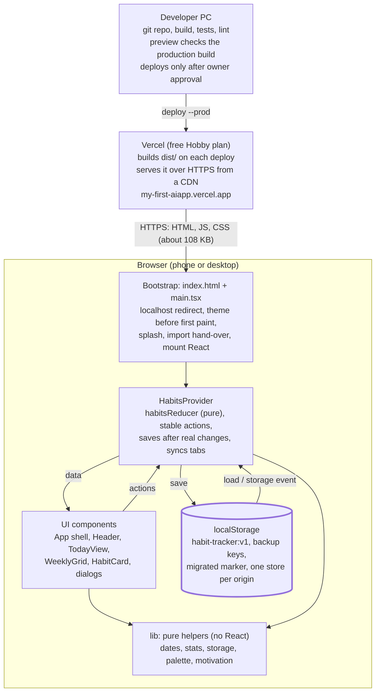
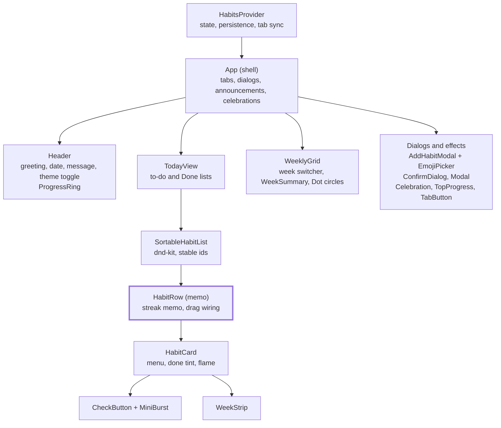

# Habits App — Design Document

Last updated: 2026-10-21 · Editable version: [Claude Doc](https://claude.ai/artifact/MscpYLyawrWsfPrFEN1jEf) · Live app: <https://my-first-aiapp.vercel.app>

## 1. Use cases

The app serves one primary actor, the **User** tracking their own habits on a phone or desktop browser, and one secondary actor, the **Maintainer** who builds and deploys it. All 17 use cases below are implemented and tested in the current release.

| ID | Use case | Actor | Main flow | Acceptance criteria |
| --- | --- | --- | --- | --- |
| UC-01 | Add a habit | User | Tap + (or "Add your first habit") → enter name → pick emoji and color → Add habit | Name required, trimmed, 1–40 characters; Add disabled until valid; emoji defaults to ✨; new habit appears at the end of Today's list |
| UC-02 | Edit a habit | User | ⋯ menu on a card → Edit → change name, emoji or color → Save changes | Same validation as UC-01; history and streak are kept |
| UC-03 | Delete a habit | User | ⋯ menu → Delete → confirm in dialog | Confirmation required; habit and all its check-ins are removed |
| UC-04 | Check off a habit for today | User | Tap the circle on a habit card | Circle fills with the habit color, checkmark draws, haptic buzz, ripple; card turns green with a ✓ badge; header ring updates (e.g. 2/3) |
| UC-05 | Undo a check-off | User | Tap a checked circle again | Today's check-in is removed and the card returns to the to-do list immediately |
| UC-06 | See current streak | User | View any habit card | Shows 🔥 N days; counts back from today, or from yesterday if today isn't done yet; a missed day resets to "Start a streak" |
| UC-07 | Log a missed day this week | User | Tap a past day in the card's Mon–Sun strip | Past days toggle; future days are disabled; streak and weekly stats update at once |
| UC-08 | Review the week | User | Open the Week tab; use ‹ › to page weeks | Summary ring (% of possible check-ins), check-ins and perfect-day counts, a daily message, and a circle grid per habit; past cells toggle; cannot page past the current week |
| UC-09 | Keep finished habits out of the way | User | Check off a habit; tap the "N Done ✓" row to fold or unfold | A checked card stays ~0.9 s for its animation, then moves to Done; fold state is remembered; "All done for today!" banner when nothing is left |
| UC-10 | Reorder habits | User | Drag a card's grip handle (mouse or touch), or Tab to it and use Space + arrow keys | New order is saved and used in both tabs; page scrolling is unaffected outside the handle |
| UC-11 | Feel rewarded | User | Complete the first habit of the day; complete the last one | Mini confetti burst on the first check-in; full-screen confetti + "Perfect day! 🎉" on the last; skipped under reduced motion |
| UC-12 | Switch theme | User | Tap the theme icon in the header | Cycles system → light → dark; choice is saved and applied before first paint on the next visit |
| UC-13 | Keep data between visits | User | Close the browser and return later | All habits, check-ins, order, theme and fold state are restored; nothing is written just by opening the app |
| UC-14 | Use it with assistive tech | User | Navigate by keyboard or screen reader | Skip link, visible focus ring, labelled controls, live announcements of each check-in; WCAG 2.2 AA contrast |
| UC-15 | Use it on a phone | User | Open the live URL; optionally Add to Home Screen | Layout fits 375 px with no horizontal scroll; tap targets ≥ 24 px; keeps working without a connection while the page stays open |
| UC-16 | Recover habits from an old address | User | Open localhost:5173 once (development only) | Habits saved under localhost are carried to 127.0.0.1 and merged once; no duplicates; deleted habits are not re-imported |
| UC-17 | Release a new version | Maintainer | Build and test locally → user approves → `npx.cmd vercel deploy --prod` | Deploys only after explicit user approval; free Hobby plan only; live URL updates in place |

- [ ] Open question: should UC-15 add a proper home-screen icon and web app manifest?

## 2. Introduction and overview

Habits is a single-page web app for building daily routines: add a habit with a name and emoji, check it off each day, and watch a streak grow. It is live at <https://my-first-aiapp.vercel.app> and runs entirely in the browser, with no server, account or sign-in.

**Product feel.** Clean, motivating and satisfying, in the spirit of Streaks and Habitify: minimal screens, one tap per check-in, and small rewards (animations, confetti, streak flames) for showing up.

**Goals**

- One-tap daily check-in with immediate, delightful feedback
- Clear motivation: current streak per habit and a weekly visual summary
- Data that survives closing the browser, with no account
- Usable on a phone, by keyboard and with a screen reader (WCAG 2.2 AA)
- Free hosting on Vercel's Hobby plan

**Non-goals (current release)**

- Accounts, cloud sync or sharing data between devices
- Weekday-only schedules in the UI (the data model supports them)
- Statistics beyond the current week (longest streak, heatmaps)
- Export/import to a file, reminders and notifications

**Current status**

| Item | State |
| --- | --- |
| Live URL | <https://my-first-aiapp.vercel.app> (Vercel project my-first-aiapp, Hobby plan) |
| Source | Local git repo, branch master, no remote |
| Tests | 56 automated tests (unit, component, accessibility, render performance) |
| Build | 1 HTML, 1 JS and 1 CSS file, about 108 KB gzipped |
| Users | Single user per browser; data is per device |

## 3. System architecture

Habits is a static single-page app: Vercel builds and serves three files, and everything else (state, logic and storage) runs in the user's browser. There is no backend, database or API.

Data flows one way: UI components call actions on HabitsProvider, which updates state through a pure reducer and saves to localStorage after each real change; pure helpers in `lib/` do the date, streak, validation and colour work.

**Technology stack**

| Layer | Technology | Notes |
| --- | --- | --- |
| Language | TypeScript 6 (strict) | strict, noUncheckedIndexedAccess, no casts in app code |
| UI | React 19 | Function components and hooks; StrictMode |
| State | useReducer + React Context | One store; stable action functions |
| Styling | Tailwind CSS 4 + CSS keyframes | Warm design tokens; dark mode via a class |
| Drag and drop | dnd-kit | Pointer, touch and keyboard sensors |
| Persistence | Browser localStorage | Versioned JSON, validated on load |
| Build | Vite 8 | Output: 1 HTML, 1 JS, 1 CSS file |
| Testing | Vitest, Testing Library, jsdom, axe-core | 56 tests incl. accessibility and render counts |
| Hosting | Vercel Hobby (static CDN) | Manual deploys after approval |

**Runtime topology**

- Static files only: once loaded, the page keeps working without a connection while it stays open.
- Each browser origin has its own data; the app always uses one address (127.0.0.1 locally, the vercel.app domain live).
- Multiple tabs on the same origin stay in sync through the storage event.

## 4. Data design

All state is one JSON document, AppData, stored under a single localStorage key and saved after every change. Types live in `src/types.ts`; loading, validation and saving in `src/lib/storage.ts`.

**AppData (root)**

| Field | Type | Meaning |
| --- | --- | --- |
| version | `1` | Schema version; anything else is rejected and backed up |
| habits | `Habit[]` | All habits, displayed by order |
| completions | `Record<HabitId, DateKey[]>` | Check-in dates per habit, unique and sorted ascending |
| settings.theme | `"system" \| "light" \| "dark"` | Colour theme, default "system" |
| settings.collapseDone | `boolean` | Whether the Done section is folded, default true |

**Habit**

| Field | Type | Meaning |
| --- | --- | --- |
| id | `string` | `crypto.randomUUID()` at creation |
| name | `string` | 1–40 characters, trimmed |
| emoji | `string` | One of 40 curated emoji, default ✨ |
| color | hex `string` | One of 8 palette colours (Tailwind 600 shades, contrast-checked) |
| frequency | `{ type: "daily" } \| { type: "weekly", days: number[] }` | Schedule (days 0–6); the UI creates daily habits only |
| createdAt | ISO timestamp | Creation time |
| archived | `boolean` | Hidden when true; reserved, always false today |
| order | `number` | Display position, renumbered 0..n-1 on reorder |

**Keys and conventions**

- DateKey = `"YYYY-MM-DD"` in the user's local time zone, never UTC, so days don't shift at midnight.
- Weeks run Monday to Sunday.
- Streak = consecutive scheduled days completed, counted back from today; if today isn't done yet, counting starts from yesterday.

**Storage keys (per browser origin)**

| Key | Written when | Content |
| --- | --- | --- |
| `habit-tracker:v1` | After every real change, never on startup | The AppData JSON |
| `habit-tracker:v1:backup:<timestamp>` | Stored data can't be read | The unreadable raw text, kept before defaults are used |
| `habit-tracker:v1:migrated` | Old localhost data handed over | Timestamp; stops a second import |

**Integrity rules**

1. Validate on load: `parseData` checks every field; id and name are required, other fields get defaults, invalid or duplicate dates are dropped.
2. Migrate on load: legacy low-contrast colours (500 shades) map to their 600 replacements.
3. Never lose data silently: unreadable data is copied to a backup key before the app starts fresh.
4. Never write on open: the loaded data is not saved back, so a faulty load cannot overwrite storage.
5. Skip identical writes: a save whose JSON equals the last written value is skipped, which also stops two tabs echoing each other.
6. Cross-tab sync: the storage event replaces in-memory state with the other tab's validated data.

**Address migration.** localhost and 127.0.0.1 are different storage origins. `index.html` redirects localhost to 127.0.0.1 and passes any habits saved there in the URL fragment (`#import=…`, never sent to a server). On arrival, `mergeData` unions habits by id and check-ins by date, then the fragment is removed from the address bar. The live site has one address, so this only affects local development.

## 5. Interface design

The app has no network API: its interfaces are the internal module contracts below and a few browser APIs. UI components change data only through the `useHabits()` actions, which dispatch reducer actions; nothing else writes storage.

**State API: `useHabits()` (`src/state/habitsContext.ts`)**

| Function | Parameters | Effect |
| --- | --- | --- |
| data | (value) | Current AppData, read-only |
| addHabit | `draft: { name, emoji, color }` | Creates a daily habit, appended after the last one |
| updateHabit | `id, changes: Partial<draft>` | Renames or restyles a habit |
| deleteHabit | `id` | Removes the habit and its check-ins |
| toggleCompletion | `id, date: DateKey` | Adds or removes one check-in |
| reorderHabits | `ids: HabitId[]` (full list, in order) | Renumbers order 0..n-1 |
| setTheme | `"system" \| "light" \| "dark"` | Changes the theme |
| setCollapseDone | `boolean` | Folds or unfolds the Done section |

All action functions are created once and never change identity, so they are safe to pass to memoized components.

**Reducer actions (`src/state/habitsReducer.ts`)**

`ADD_HABIT`, `UPDATE_HABIT`, `DELETE_HABIT`, `TOGGLE_COMPLETION`, `REORDER`, `SET_THEME`, `SET_COLLAPSE_DONE` and `REPLACE` (cross-tab sync). The reducer is pure; random ids and timestamps are created before dispatch. An exhaustive switch makes an unhandled action a compile error.

**Library functions (`src/lib`)**

| Module | Functions | Purpose |
| --- | --- | --- |
| storage.ts | loadData, saveData, parseData, mergeData, importFromUrl | Read, validate, write, merge and hand-over of AppData |
| stats.ts | currentStreak, completionSet | Streak calculation; cached Set of check-in dates per habit |
| dates.ts | toDateKey, addDays, startOfWeek, weekDays, format* | Local-time date keys and display formats |
| palette.ts | colorAt, contrastRatio, readableTextOn, migrateColor | Colour palette and WCAG contrast helpers |
| motivation.ts | messageForDay | One message per day from a list of 30 |

**Browser interfaces used**

| Interface | Used for |
| --- | --- |
| localStorage + storage event | Persistence and cross-tab sync |
| navigator.storage.persist() | Asks the browser not to evict data (it may decline) |
| matchMedia (prefers-color-scheme, prefers-reduced-motion) | System theme and reduced motion |
| navigator.vibrate() | Haptic buzz on supported phones |
| history.replaceState, location.hash | Removing the `#import=` fragment after a hand-over |
| ARIA live region | Screen-reader announcements of check-ins |

**Build and deploy interface**

| Command | Purpose |
| --- | --- |
| `npm run dev` | Dev server at http://127.0.0.1:5173 |
| `npm test` / `npm run build` / `npm run lint` | Tests, type-check + production build, linting |
| `npm run preview` | Serves the production build at http://127.0.0.1:4173 |
| `npx.cmd vercel deploy --prod` | Publishes to Vercel, only after the user approves |

## 6. Component design

The UI is a tree of small function components under one App shell; each habit card is a memoized HabitRow, so checking off one habit re-renders only that card (verified by a render-count test).

HabitsProvider owns all data; App passes it down as props and receives stable callbacks back, so memoization holds across renders.

**Components**

| Component | File | Responsibility |
| --- | --- | --- |
| HabitsProvider | state/HabitsProvider.tsx | Holds AppData in a reducer; saves after changes; syncs tabs; exposes useHabits() |
| App | App.tsx | Tabs, dialogs, screen-reader announcements, burst and celebration timing, theme class |
| Header + ProgressRing | components/Header.tsx, ProgressRing.tsx | App bar, date, greeting with name, daily message, today's progress ring |
| TodayView | components/TodayView.tsx | Splits habits into to-do and Done (with the 0.9 s linger); empty and all-done states |
| SortableHabitList | components/SortableHabitList.tsx | dnd-kit context with constant sensors and modifiers; one per list |
| HabitRow | components/TodayView.tsx | Memoized row: drag wiring, done state and streak (memoized) |
| HabitCard | components/HabitCard.tsx | Card layout, ⋯ menu, done tint and badge, flame pulse, card bounce |
| CheckButton + MiniBurst | components/CheckButton.tsx | Check circle with press, pop, haptic buzz, ripple and first-check confetti |
| WeekStrip | components/WeekStrip.tsx | Mon–Sun day buttons on each card for backfilling |
| WeeklyGrid + WeekSummary + Dot | components/WeeklyGrid.tsx | Week paging, summary ring and stats, animated circle grid |
| AddHabitModal + EmojiPicker | components/AddHabitModal.tsx, EmojiPicker.tsx | Create/edit form with validation and keyboard-navigable pickers |
| Modal, ConfirmDialog | components/ui/ | Accessible dialog: focus trap, Esc to close, focus return |
| Celebration, CelebrationToast, TopProgress | components/ | Confetti, "Perfect day" toast, tab-switch progress bar |

**Hooks**

| Hook | Purpose |
| --- | --- |
| useHabits | Read data and call actions from any component |
| useClock | Today's date and hour, refreshed each minute and on tab focus |
| useStableCallback | Fixed-identity callback that always runs the latest code |
| useSortableWiring | Turns dnd-kit's useSortable into the card's ref, style and handle props |
| useTransient (in App) | State that resets itself after a delay (burst, celebration, progress bar) |

**Design rules**

- Pure logic stays in `lib/` and is unit-tested without React.
- Components receive data as props; only App calls `useHabits()`.
- Objects passed to dnd-kit (sensor options, modifiers, id lists) keep their identity unless their contents change.

## 7. User interface design

The interface is one centred, mobile-first column (max 576 px) with two tabs, Today and Week, and a floating + button between them. Everything else is a dialog or an in-place animation.

**Screens and regions**

| Screen / region | Contents |
| --- | --- |
| Header (both tabs) | "Habits" app bar with theme toggle; date in small capitals; "Good afternoon, TestName 👋"; daily motivational line; progress ring (e.g. 2/3) |
| Today: empty state | 🌱 "Small steps, every day" and an "Add your first habit" button |
| Today: to-do list | Habit cards: grip handle, emoji tile, name, 🔥 streak, ⋯ menu, check circle, Mon–Sun strip |
| Today: Done section | "N Done ✓" row that folds or unfolds the finished cards (green tint, ✓ badge) |
| Today: all done | Green "All done for today!" banner |
| Week | Week switcher (‹ This week ›); summary card with % ring, check-ins, perfect days and a message; grid of circles per habit with an N/7 tally |
| New / Edit habit dialog | Bottom sheet on phones, centred on larger screens: Name with 0/40 counter, 8×5 emoji grid, 8 colour swatches, submit button |
| Delete dialog | "Delete “name”?" with Cancel and Delete |
| Bottom bar | Today tab, + button, Week tab |

**Visual language**

- Warm palette: cream background (#faf7f2), warm stone greys, plum-purple accent; dark mode uses a warm near-black (#0f0d0b).
- Each habit has one accent colour from 8 options; done states use green.
- Rounded cards (24 px corners), soft shadows, generous whitespace, system/Inter font.
- Done is never shown by colour alone: a check mark is always drawn too.

**Motion (all skipped when the OS asks for reduced motion)**

| Moment | Animation |
| --- | --- |
| App start | Pulsing logo splash until the app mounts |
| Check-off | Button press-in, pop, side-to-side haptic buzz, ripple, checkmark draw, card bounce |
| First check-in of the day | Mini confetti burst from the button |
| Last check-in of the day | Full-screen confetti and a "Perfect day! 🎉" toast |
| Streak grows | Flame pulse |
| Tab switch | Content fade and a thin top progress bar |
| Week view load | Summary slides up, ring sweeps, rows fade in, circles pop in one by one |

**Responsive and accessible behaviour**

- Works from 375 px wide with no horizontal scroll; tap targets at least 24 px, main buttons 48 px.
- Text contrast at least 4.5:1 and icons/borders at least 3:1 in both themes (checked by axe and unit tests).
- Full keyboard use: skip link, purple focus ring, arrow keys in the emoji and colour pickers, Esc closes dialogs and menus, keyboard drag-and-drop.
- Screen readers hear each check-in ("Read done today. 2 of 3 done today.") and get labels for every icon button and day circle.

## 8. Security solution and risks

The attack surface is small: a static site with no backend, no accounts, no cookies and no outgoing data. Habit data never leaves the user's browser, so the main risks are local data loss, a shared device, and the integrity of the code being served.

**Security measures in place**

- Served only over HTTPS from Vercel's CDN; the production URL is public, while one-off deployment URLs are protected by Vercel Authentication.
- All user text (habit names) is rendered through React, which escapes it; the app never injects raw HTML.
- All stored or imported data passes through `parseData` validation before use; invalid data is rejected or backed up, never trusted.
- No secrets, keys or credentials exist in the code or repo; the `.vercel` link folder is git-ignored.
- No analytics, trackers or third-party scripts at runtime; the only network requests load the app itself.
- Releases happen only after the owner approves, on the free Hobby plan (no paid features).

**Risk register**

| Risk | Likelihood | Impact | Mitigation in place | Residual risk / recommendation |
| --- | --- | --- | --- | --- |
| Data lost when the user clears site data, uses private browsing or the browser evicts storage | Medium | High | Writes on every change; storage.persist() requested; backups of unreadable data | No cloud copy. Recommend an Export/Import backup file |
| Habits visible to anyone using the same device or browser profile | Medium | Low | None (no sign-in by design) | Accepted for a personal tracker; document it for users |
| Crafted link with `#import=` adds unwanted habits to a user's data | Low | Low | Data is validated and merged, never overwrites; names are escaped | importFromUrl runs on every host. Recommend limiting it to 127.0.0.1 |
| Vulnerable or compromised npm dependency | Low | Medium | Small dependency set; package-lock.json pins versions | Run npm audit before each release; keep dependencies updated |
| No Content-Security-Policy or anti-framing headers | Low | Low | No third-party scripts; no sensitive actions | Recommend vercel.json headers (CSP, X-Frame-Options, Referrer-Policy) |
| Unreviewed change deployed to production | Low | Medium | Deploy only on explicit approval; tests, build and lint run first | Add a Git remote and CI to gate deploys |
| Unexpected hosting cost | Low | Medium | Hobby plan only; standing rule never to buy or upgrade | Check Vercel Settings → Billing periodically |
| Corrupted data after a buggy release | Low | High | Validation, no writes on open, backup keys, 56 tests | Bump the schema version with a migration when the format changes |

## 9. Assumptions and dependencies

The design assumes one person per browser, a modern evergreen browser with localStorage enabled, and a small number of habits (typically 3–10). It depends on 6 runtime packages, a standard React toolchain and Vercel's free hosting.

**Assumptions**

- One user per browser profile; no need to share or sync between devices.
- localStorage is available and persistent (not private browsing, not blocked by policy).
- The device clock and time zone are correct; dates and streaks follow local time.
- Daily habits only; weeks start on Monday.
- A modern browser: Chrome, Edge, Firefox or Safari from the last two years (ES2023, CSS custom properties).
- Habit counts stay small enough to show on one scrolling page without pagination.
- The greeting uses the placeholder name TestName until a name setting is added.

**Runtime dependencies**

| Package | Version | Used for |
| --- | --- | --- |
| react, react-dom | 19.3 | UI rendering and state |
| @dnd-kit/core, sortable, modifiers, utilities | 6.3 / 10.0 / 9.0 / 3.2 | Drag-and-drop reordering (mouse, touch, keyboard) |
| lucide-react | 1.61 | Icons |
| clsx | 2.1 | Conditional class names |
| tailwindcss + @tailwindcss/vite | 4.3 | Styling |

**Development dependencies**

| Tool | Version | Used for |
| --- | --- | --- |
| TypeScript | 6.0 (strict) | Type checking |
| Vite + @vitejs/plugin-react | 8.3 / 6.1 | Dev server and production build |
| Vitest, Testing Library, jsdom | 5.0 / 16.3 / 30.1 | Unit and component tests |
| axe-core | 4.14 | Automated accessibility checks |
| oxlint | 1.88 | Linting |
| Node.js / npm | 24.19 / 11.17 | Toolchain on the development machine |

**External services**

| Service | Plan | Dependency |
| --- | --- | --- |
| Vercel | Hobby (free), account masandrakhi-8744 | Builds and hosts <https://my-first-aiapp.vercel.app> |
| npm registry | Public | Installing packages and the Vercel CLI via npx.cmd |

**Environment note.** On the development PC, PowerShell blocks `npx.ps1`, so commands use `npx.cmd`; the execution policy is left unchanged.

## 10. Glossary of terms

| Term | Meaning |
| --- | --- |
| AppData | The single JSON document holding all habits, check-ins and settings |
| axe / axe-core | Automated accessibility checker used in tests and browser audits |
| Backfill | Logging a check-in for a past day via the week strip or Week grid |
| Burst | The small confetti pop from a habit's check button on the first check-in of the day |
| Check-in / completion | A record that a habit was done on a given date |
| Component (React) | A reusable piece of UI, such as HabitCard or WeeklyGrid |
| Context (React) | Shared state passed down the component tree; here, useHabits() |
| CSP | Content-Security-Policy, a header limiting which scripts a page may run |
| DateKey | A local date written as YYYY-MM-DD |
| dnd-kit | The drag-and-drop library behind reordering |
| Done section | The foldable list of habits already checked off today |
| Hobby plan | Vercel's free tier |
| Linger / sink delay | The ~0.9 s a just-checked card stays in place before moving to Done |
| localStorage | The browser's per-site key-value storage where all data is kept |
| Memoization | Reusing a previous render or result when its inputs haven't changed |
| Origin | Scheme + host + port; each origin has its own storage (localhost ≠ 127.0.0.1) |
| Perfect day | A day on which every habit was checked off |
| Production build | The optimized files in dist/ produced by npm run build |
| Reducer | A pure function that applies one action to the state and returns the new state |
| Reduced motion | An OS setting asking apps to minimize animation |
| SPA | Single-page application: one HTML page whose content changes without reloads |
| Streak | Consecutive scheduled days completed, counted back from today (or yesterday) |
| Tailwind CSS | Utility-class CSS framework used for styling |
| Vercel | The hosting platform that builds and serves the live site |
| Vite | The build tool and dev server |
| WCAG 2.2 AA | Web Content Accessibility Guidelines, level AA, the accessibility target |
| Week strip | The Mon–Sun row of circles on each habit card |
