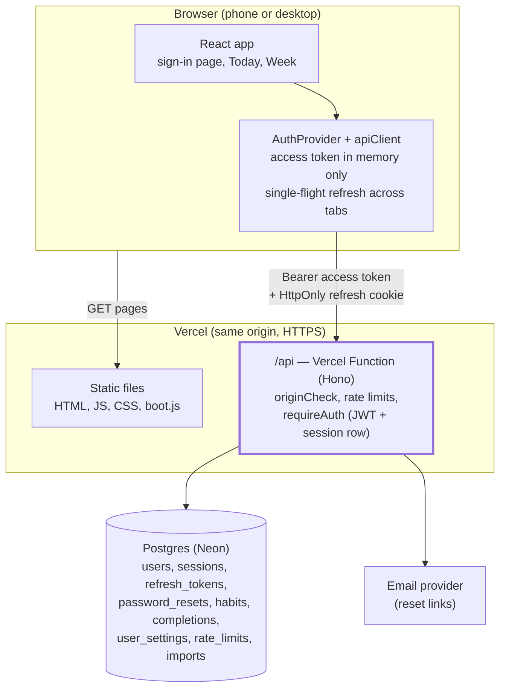
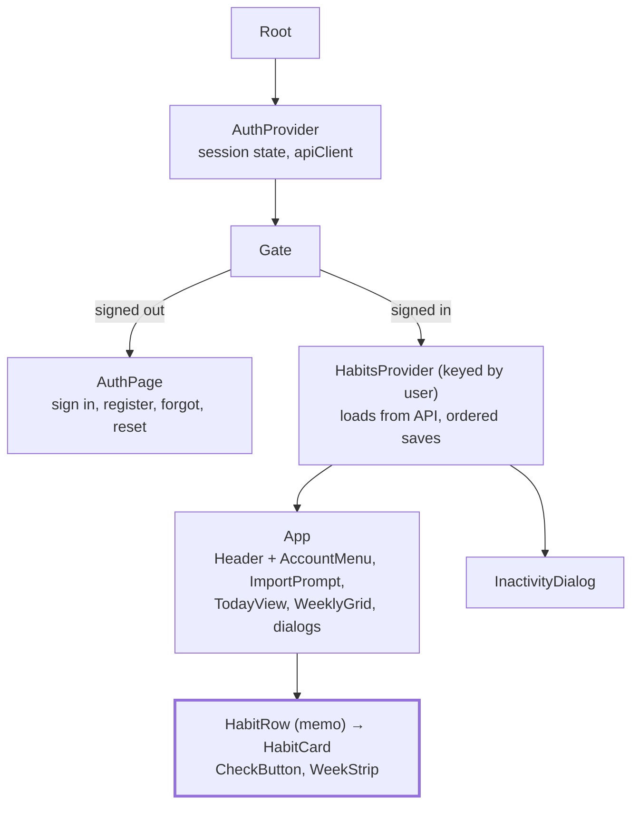

# Habits App — Design Document

Last updated: 2026-10-21 (v2: accounts and server-side data) · Earlier version (v1, device-only): [Claude Doc](https://claude.ai/artifact/MscpYLyawrWsfPrFEN1jEf) · Live app: <https://my-first-aiapp.vercel.app> (still v1 until v2 is deployed)

## 1. Use cases

Actors: the **User**, who tracks their own habits from any browser after signing in, and the **Maintainer**, who builds and deploys the app. Every habit use case acts only on the signed-in user's data.

| ID | Use case | Actor | Main flow | Acceptance criteria |
| --- | --- | --- | --- | --- |
| UC-01 | Create an account | User | "Create an account" → optional first name, email, password → Create account | Email unique (case-insensitive); password 12–128 characters, not common, not containing the email name; signed in on success |
| UC-02 | Sign in | User | Email + password → Sign in | Server verifies the Argon2id hash; wrong email or password gives one generic message; 5 failures per email or 20 attempts per IP in 15 minutes → "Too many attempts" |
| UC-03 | Stay signed in while active | User | Use the app normally | 15-minute access tokens refresh silently; reloading the page restores the session from the HttpOnly refresh cookie |
| UC-04 | Inactivity sign-out | User | Stop using the app | "Still there?" warning at 13 minutes with a countdown; "Stay signed in" keeps the session; after 15 minutes without activity the server rejects the session and the app shows "signed out after 15 minutes of inactivity" |
| UC-05 | Sign out | User | Avatar menu → Sign out | Server revokes the session and refresh token; every open tab returns to the sign-in page |
| UC-06 | Reset a forgotten password | User | Forgot password? → email → link in email → new password | Same answer whether or not the account exists; each link valid 30 minutes and single use (asking again doesn't cancel earlier links; using any one retires them all); afterwards every session is signed out and a "password changed" email is sent |
| UC-07 | Import habits from this device | User | After first sign-in, "Import N habits from this device?" → Import | Imported once into the signed-in account with history; the device copy is deleted afterwards |
| UC-08 | Add a habit | User | Tap + → name, emoji, colour → Add habit | Name required, trimmed, 1–40 characters; saved on the server under the user's id |
| UC-09 | Edit or delete a habit | User | ⋯ menu → Edit / Delete (confirm) | Only the owner's habit changes; delete removes its history |
| UC-10 | Check off a habit for today | User | Tap the circle | Fills, pops, buzzes, ripples; card turns green; saved immediately; on a failed save the app reloads from the server and says so |
| UC-11 | Undo a check-off | User | Tap a checked circle | Check-in removed; card returns to the to-do list |
| UC-12 | See current streak | User | View a habit card | 🔥 N days counted back from today (or yesterday if today isn't done) |
| UC-13 | Log a missed day this week | User | Tap a past day in the card's Mon–Sun strip | Past days toggle; future days disabled; server rejects dates more than a day ahead |
| UC-14 | Review the week | User | Week tab; ‹ › to page weeks | Completion ring, check-ins, perfect days, circle grid per habit |
| UC-15 | Keep finished habits out of the way | User | Check off; tap "N Done ✓" to fold/unfold | Card sinks to Done after ~0.9 s; fold state saved to the account |
| UC-16 | Reorder habits | User | Drag the grip (mouse, touch) or Space + arrows | New order saved; server accepts only the user's own complete set of habits |
| UC-17 | Feel rewarded | User | First and last check-in of the day | Mini burst, then full confetti + "Perfect day! 🎉"; skipped under reduced motion |
| UC-18 | Switch theme | User | Theme icon | system → light → dark; saved to the account and applied before first paint on this device |
| UC-19 | Use it on any device | User | Sign in on phone or desktop | Same habits everywhere; nothing about habits is stored in the browser |
| UC-20 | Use it with assistive tech | User | Keyboard or screen reader | WCAG 2.2 AA: labels, focus ring, skip link, live announcements, accessible sign-in form |
| UC-21 | Release a new version | Maintainer | Build and test → owner approves → deploy | Deploys only after explicit approval; free plans only; database migrations run in the deploy's build, and a failed migration fails the deploy |

## 2. Introduction and overview

Habits is a motivating daily habit tracker: add habits with a name and emoji, check them off each day, and watch streaks grow. Version 2 adds **accounts**: users sign in with email and password, and their habits are stored on the server, private to them.

**Product feel.** Clean, motivating and satisfying, in the spirit of Streaks and Habitify.

**Goals**

- One-tap daily check-in with delightful feedback
- Secure accounts: server-verified passwords, short-lived tokens, 15-minute inactivity timeout, rotating refresh tokens
- Strict per-user data isolation, enforced on the server for every endpoint
- The same habits on every device; nothing about habits stored in the browser
- Accessible (WCAG 2.2 AA), mobile-first, free hosting

**Non-goals (this release)**

- Social sign-in, two-factor authentication, email verification
- Sharing habits between users; admin tools
- Weekday-only schedules in the UI, long-range statistics, reminders

**Current status**

| Item | State |
| --- | --- |
| Live URL | <https://my-first-aiapp.vercel.app> serves v1 (device-only) until v2 is deployed |
| v2 | Complete locally; not deployed (needs a database and environment variables, with the owner's approval) |
| Tests | 101 automated tests: 31 server (auth, sessions, isolation) + 70 UI |
| Build | About 129 KB gzipped JavaScript |

## 3. System architecture

The browser app and the API share one origin. The API is a Vercel Function; data lives in Postgres.

**Technology stack**

| Layer | Technology | Notes |
| --- | --- | --- |
| UI | React 19, TypeScript (strict), Tailwind CSS 4 | Unchanged look and features from v1 |
| API | Hono on Vercel Functions (Node.js runtime) | One function serves all `/api/*` routes |
| Database | Postgres via Drizzle ORM | Neon in production; PGlite (in-process Postgres) for local dev and tests |
| Passwords | Argon2id (`@node-rs/argon2`) | m = 19 MiB, t = 2, p = 1 |
| Tokens | JWT HS256 (`jose`) + opaque refresh tokens | Signing keys rotate via `kid` |
| Validation | zod schemas shared by client and server | `src/shared/schemas.ts` |
| Email | Gmail SMTP via nodemailer, or Resend's HTTP API (production; chosen by `server/mail/select.ts`), file outbox (development) | `server/mail/mailer.ts`, `server/mail/select.ts` |
| Tests | Vitest; server tests against real PGlite; UI tests with an in-memory fake API | |

**Local development:** `npm run dev` starts Vite on 127.0.0.1:5173 and the API on 127.0.0.1:8787; Vite proxies `/api`, so cookies and origins behave as in production. Data is in `.data/pglite`, emails in `.data/outbox`.

## 4. Data design

Every row of user data carries `user_id`. Completions also have a composite foreign key `(habit_id, user_id) → habits(id, user_id)`, so the database itself refuses a check-in that points at another user's habit.

| Table | Key columns | Purpose |
| --- | --- | --- |
| users | id, email (unique, lowercased), password_hash, name, password_changed_at | Accounts; never plaintext passwords |
| sessions | id, user_id, created_at, **last_activity_at**, expires_at (7 days), revoked_at, revoke_reason | One per sign-in; drives the inactivity timeout; the "family" for refresh rotation |
| refresh_tokens | id, session_id, token_hash (SHA-256), expires_at, used_at, replaced_by, revoked_at | Rotation and reuse detection |
| password_resets | id, user_id, token_hash, expires_at (30 min), used_at | Single-use reset links |
| habits | id (server-generated), **user_id**, name, emoji, color, frequency, archived, sort_order | Habits, unique (id, user_id) |
| completions | **user_id**, habit_id, date, PK (habit_id, date) | Check-ins |
| user_settings | user_id, theme, collapse_done | Per-user preferences |
| rate_limits | key (HMAC of IP or email), window_start, count | Brute-force protection shared by all instances |
| imports | user_id, device_import_id | Makes the one-time device import idempotent |

**Conventions.** Dates are local `YYYY-MM-DD`; weeks start Monday; streaks count consecutive scheduled days. All expiry decisions use the injected server clock.

**Device storage (browser).** Only `habits:theme` (for first paint) and `habits:device-id` (import idempotency). Legacy `habit-tracker:v1` data from v1 is read once for the import prompt and deleted after a successful import.

**Migrations.** Drizzle generates SQL into `server/db/migrations`; `npm run db:migrate` applies them to the database in `DATABASE_URL`. Vercel runs it in every deployment's build (`buildCommand` in `vercel.json`), because the database secrets are only readable there; a failed migration fails the deploy, and already-applied migrations are skipped. Because migrations run before the API is packaged, a later build failure leaves the current version running against the new schema, so migrations must stay backward compatible (add columns and tables; rename or drop only in a later release). Preview deployments migrate their own isolated database copy.

## 5. Interface design

**HTTP API.** JSON only. Errors: `{ "error": { "code", "message", "fields"? } }`. State-changing requests must come from the app's origin (else 403).

| Method & path | Auth | Purpose | Main responses |
| --- | --- | --- | --- |
| POST /api/auth/register | — | Create account and sign in | 201 · 400 · 409 · 429 |
| POST /api/auth/login | — | Sign in | 200 · 401 `invalid_credentials` · 429 |
| POST /api/auth/refresh | cookie | Rotate refresh token, new access token | 200 · 401 `session_expired` / `invalid_refresh` |
| POST /api/auth/logout | cookie/Bearer | Revoke session | 204 |
| POST /api/auth/password/forgot | — | Email a reset link | always 202 |
| POST /api/auth/password/reset | — | Set new password, revoke all sessions | 204 · 400 `invalid_reset_link` |
| POST /api/session/keepalive | Bearer | "Stay signed in" (counts as activity) | 204 |
| GET /api/me · PATCH /api/me/settings | Bearer | Profile and settings | 200 |
| GET · POST /api/habits | Bearer | List all (with completions, settings) · create | 200 · 201 |
| GET · PATCH · DELETE /api/habits/:id | Bearer | One habit | 200/204 · 404 if not the caller's |
| PUT · DELETE /api/habits/:id/completions/:date | Bearer | Check in / undo | 204 · 400 · 404 |
| PUT /api/habits/order | Bearer | Reorder (must list exactly the caller's habits) | 204 · 400 |
| POST /api/import | Bearer | One-time import of device data | 200 |

Status codes: **401** missing, invalid or expired authentication (`token_expired` triggers one silent refresh); **404** for any habit that isn't the caller's (indistinguishable from a missing one); **403** failed origin check; **429** rate limited with `Retry-After`.

**Client interfaces.** `useAuth()` (state, signIn, register, requestReset, resetPassword, signOut, keepAlive, idleMs) and `useHabits()` (data, status, syncError, and the same habit actions as v1, now saved to the API in order with optimistic updates).

## 6. Component design

| Component / module | Responsibility |
| --- | --- |
| `auth/apiClient.ts` | Access token in memory; Bearer requests; one refresh then retry on `token_expired`; single-flight refresh via Web Locks; cross-tab session/sign-out via BroadcastChannel; tracks activity |
| `auth/AuthProvider.tsx` | Restores the session on load, exposes sign-in/out/register/reset |
| `components/auth/AuthPage.tsx` | Accessible forms with client-side checks mirroring the server, reset-link handling |
| `components/auth/InactivityDialog.tsx` | 13-minute warning, 15-minute sign-out; only a click counts as activity |
| `components/auth/ImportPrompt.tsx` | One-time import of v1 device data |
| `state/HabitsProvider.tsx` | Server is the source of truth; optimistic updates; on a failed save, reload and show a toast |
| `server/middleware.ts` | `requireAuth` (JWT + live session + inactivity), `originCheck`, error mapping, request logging |
| `server/repo/habits.ts` | All data access; every function requires an `AuthedUserId` and filters by it |
| `server/auth/*` | Passwords, tokens, sessions, refresh rotation, rate limits, reset |

Unchanged from v1: memoized habit rows (toggling re-renders one card), shared date/streak helpers, the animation and accessibility components.

## 7. User interface design

The sign-in page uses the app's visual language: cream background, rounded card, the Habits brand mark, plum accent button, 375 px-first layout.

| Screen | Contents |
| --- | --- |
| Sign in | Email, password (show/hide), Sign in, "Forgot password?", "Create an account"; notice banner when signed out for a reason |
| Create account | First name (optional), email, new password with guidance, Create account |
| Forgot / reset | Email → generic confirmation; reset link → new password → "Password changed" notice |
| App header | Brand, theme toggle, avatar menu (name, email, Sign out), greeting with the user's name |
| Import card | "Import N habits from this device?" with Import / Not now |
| Inactivity dialog | "Still there?" with a live countdown, Stay signed in / Sign out |
| Loading / errors | Skeleton cards while loading; retry card if loading fails; toast when a save fails |

Today, Week, dialogs, motion and accessibility behaviour are unchanged from v1 (see the Claude Doc).

## 8. Security solution and risks

**Measures**

- Passwords: Argon2id with per-hash salt; NIST-style policy; constant-time-ish login (dummy hash for unknown emails); generic error messages.
- Tokens: 15-minute HS256 access tokens kept only in memory; opaque 256-bit refresh tokens stored as SHA-256 hashes, in `HttpOnly; Secure; SameSite=Strict; Path=/api/auth` cookies with the `__Secure-` prefix.
- Sessions: 15-minute inactivity timeout checked atomically on every authenticated request and on refresh (refresh is not activity); 7-day absolute lifetime; revoked on logout, idle, reuse, or password reset.
- Rotation: each refresh token works once; reuse revokes the whole session (token family); concurrent tabs coordinate so legitimate use never looks like reuse.
- Authorization: user id only from the verified token and live session; every query filtered by it; composite foreign key as a second line of defence; cross-user requests get 404.
- Abuse: Postgres-backed rate limits per IP and per email; request body limit 512 KB; strict input validation.
- CSRF: Bearer header for data; origin check and JSON-only bodies on every state-changing request.
- Transport and headers: HTTPS (HSTS), CSP `default-src 'self'` with no inline scripts, `frame-ancestors 'none'`, `nosniff`, `no-referrer`, Permissions-Policy; `Cache-Control: no-store` on API responses.
- Secrets and logs: secrets only in environment variables; logs never include bodies, passwords, tokens, cookies or hashes (redaction tested).

**Logging and debugging**

- Every API response carries `X-Request-Id`; error bodies include the same `requestId`, and the app shows it as "(ref …)" for server faults and failed saves.
- One JSON line per request: requestId, method, path, status, errorCode, duration, userId, sessionId, Vercel's request id.
- `message: "security"` lines with an `event`: `login_failed` (reason `wrong_password` / `unknown_email`), `login_locked`, `rate_limited`, `login_succeeded`, `register_succeeded` / `register_conflict`, `refresh_succeeded`, `refresh_failed` (reason), `refresh_reuse_detected` (warn), `session_expired` (`inactive` / `expired`), `session_invalid`, `logout`, `password_reset_requested` / `completed` / `failed`, `origin_blocked` (warn), `password_rehashed`.
- Unexpected errors log name, message and stack with the request id; users see only a generic message and the reference.
- Emails appear only as `emailRef` (keyed hash) so attempts on one account can be correlated; passwords, tokens, cookies and hashes are never logged (tested).
- Browser: an error boundary replaces blank-page crashes with a Reload screen; render crashes, failed loads and saves, and uncaught errors are logged to the console as `[habits] …` with status, code and requestId.

**Risk register**

| Risk | Likelihood | Impact | Mitigation | Residual / next step |
| --- | --- | --- | --- | --- |
| Credential stuffing / brute force | Medium | High | Rate limits, generic errors, Argon2id | Add breach-list check (HIBP k-anonymity) and optional 2FA |
| Stolen refresh token | Low | High | HttpOnly cookie, rotation, reuse revokes family, 15-min idle, 7-day cap | — |
| XSS stealing an access token | Low | High | CSP without inline scripts, React escaping, memory-only token | — |
| Cross-user data access (IDOR) | Low | High | Scoped repository, branded user id, composite FK, 404s; tested | Consider Postgres row-level security |
| Reset emails can't reach users | Low once Gmail SMTP is configured | Medium | Mailer abstraction; SMTP or Resend chosen by environment | Gmail suits a small app (a few hundred emails a day, sent from the owner's address); move to a verified domain for a larger launch |
| Account enumeration via sign-up | Medium | Low | Generic messages elsewhere | Accepted trade-off for clear sign-up feedback |
| Database or env misconfiguration at deploy | Low | High | Config validated at startup; separate Preview/Production databases | Deploy to Preview first, with approval |
| Vulnerable dependency | Low | Medium | Lockfile; `npm audit` (0 vulnerabilities at writing) | Re-run before each release |
| Unexpected hosting cost | Low | Medium | Free plans only; standing rule never to buy or upgrade | Check billing pages |

## 9. Assumptions and dependencies

**Assumptions:** one person per account; modern browsers (Web Locks and BroadcastChannel optional, with fallbacks); correct device clock for local dates; small data per user (whole list loaded at once).

| Dependency | Use |
| --- | --- |
| React 19, Tailwind CSS 4, dnd-kit, lucide-react, clsx | UI (unchanged) |
| hono, @hono/node-server | API routing; local server |
| drizzle-orm, drizzle-kit, @neondatabase/serverless, @electric-sql/pglite | Database access, migrations, local/test Postgres |
| @node-rs/argon2, jose, zod | Password hashing, JWTs, validation |
| Vitest, Testing Library, jsdom, axe-core, oxlint, tsx, concurrently | Tests, linting, dev tooling |
| Vercel (Hobby), Neon (free), Resend (free) | Hosting, database, email — accounts created by the owner; no paid plans |

**Environment variables** (see `.env.example`): `DATABASE_URL`, `APP_ORIGIN`, `JWT_SECRETS`, `IP_HASH_SECRET`, `COOKIE_SECURE`, `MAIL_FROM`, and for email either `SMTP_USER` + `SMTP_PASS` (Gmail App Password; optional `SMTP_HOST`, `SMTP_PORT`) or `RESEND_API_KEY`.

## 10. Glossary of terms

| Term | Meaning |
| --- | --- |
| Access token | Short-lived (15 min) signed JWT proving who the user is; kept in memory |
| Argon2id | Memory-hard password-hashing algorithm |
| AuthedUserId | Branded type for a user id that came from a verified, live session |
| CSP | Content-Security-Policy header restricting what a page may load or run |
| CSRF | Cross-site request forgery: another site making requests as the user |
| IDOR | Insecure direct object reference: accessing another user's data by changing an id |
| Inactivity timeout | Sign-out after 15 minutes without meaningful activity, separate from token expiry |
| Neon | Hosted serverless Postgres |
| PGlite | Postgres compiled to WebAssembly, used in-process for development and tests |
| Refresh token | Long-lived opaque token in an HttpOnly cookie, exchanged for new access tokens |
| Rotation / reuse detection | Each refresh token works once; presenting a used one revokes the session |
| Session | Server record of one sign-in, with last activity and expiry |
| Single-flight refresh | Only one refresh at a time across tabs, sharing the result |
| Streak | Consecutive scheduled days completed, counted back from today (or yesterday) |
| WCAG 2.2 AA | Accessibility standard the app targets |
